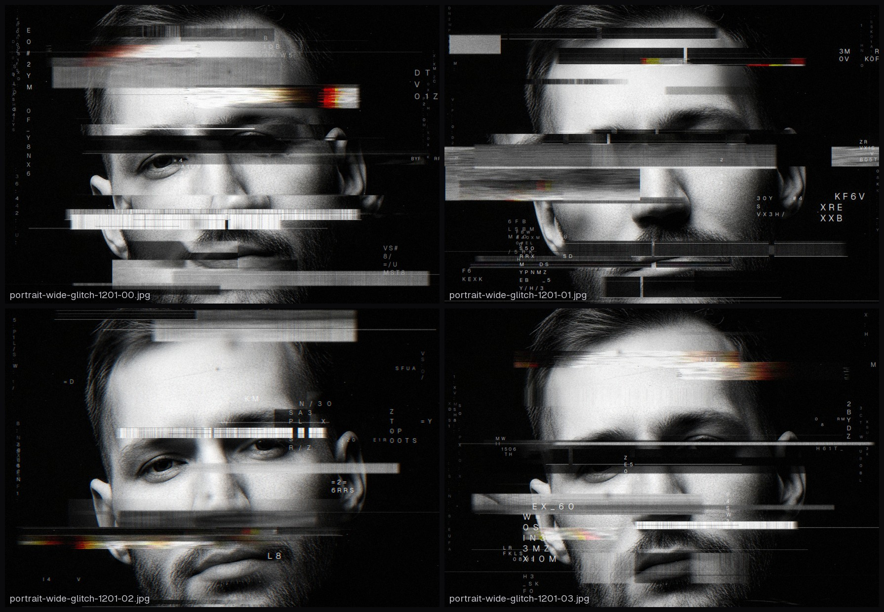

# Cyber Glitch Effect

Генератор кибер-глитча для фотографий: срезы, растяжки, рваные штрихи с дисперсией,
прогрессивное размытие, грязь и россыпь глифов. Есть CLI на Python и версия в браузере.



## Что внутри

- `glitch.py` — CLI-генератор: рандом по seed, пачка вариантов, контактный лист.
- `web/` — та же механика на canvas: перетащи фото, крути слайдеры, скачай или скопируй PNG.
- `out/` — примеры результата.

## Быстрый старт

```bash
python3 -m pip install -r requirements.txt

# четыре варианта
python3 glitch.py photo.jpg -o out -n 4 --seed 101

# палитра от самого снимка
python3 glitch.py photo.jpg -o out --tint auto

# папка целиком плюс контактный лист
python3 glitch.py ./photos -o out -n 3 --sheet
```

Результат: `out/<имя>-glitch-<seed>-<номер>.png` и `out/sheet-<seed>.jpg`.

Один и тот же seed на том же файле даёт тот же результат.

## Параметры

| Флаг | Что делает | По умолчанию |
| --- | --- | --- |
| `--tint` | `none`, `auto`, `blue`, `orange`, `green`, `magenta`, `amber`, `cyan`, `violet` или `#hex` | `none` |
| `--intensity` | сила и плотность полос, 0–2 | `1.0` |
| `--dirt` | грязь: шум, линии, пятна, пыль, 0–2 | `1.2` |
| `--bg-blur` | прогрессивное размытие случайных участков, 0–2 | `1.0` |
| `--jpeg-dirt` | блочность кодека, 0–1 | `0.45` |
| `--bars` | сколько полос-оверлеев, 0–2 | `1.0` |
| `--feather` | мягкость краёв: 0 — рубленые, 2 — мягкие | `1.0` |
| `--preserve` | доля исходного цвета, 0–1 | `0.12` |
| `--contrast` | контраст тонировки | `1.08` |
| `--text` | `on` / `off` | `on` |
| `--text-density` | плотность глифов | `1.0` |
| `--mono` | моноширинный шрифт для глифов | выкл. |
| `--grain`, `--vignette`, `--blur`, `--aberration` | финиш | `0.03`, `0.32`, `0.6`, `1.0` |
| `--width`, `--height` | размер результата | как у исходника |
| `--format` | `png`, `jpg`, `webp` | `png` |

## Как устроен эффект

1. Тонировка: по умолчанию выключена, остаются исходные цвета с лёгким контрастом.
   С `--tint blue` и другими пресетами кадр переводится в один оттенок.
2. Полосы: срез со сдвигом, растяжка куска внутри полосы, вертикальные полоски,
   горизонтальные линии, progressive и motion blur, призраки, грязные шумные полосы,
   рваный штрих с дисперсией по каналам.
3. Грязные линии и вертикальные обрывы записи.
4. Полупрозрачные полосы и светящиеся строки.
5. Глифы: кластеры строк с разрядкой, вертикальные колонки по краям.
6. Финиш: блум, аберрация, зерно, виньетка, блочность JPEG.

Полосы не тянутся от края до края: каждая занимает часть ширины, края растушёваны
и рваные. Тёмные заплатки автоматически ослабляются, чтобы не читаться чёрными плашками.

## Версия в браузере

`web/index.html` — один файл на canvas, без сборки. Шрифты Medeo лежат рядом и работают офлайн.

```bash
python3 -m http.server 8000
# открыть http://127.0.0.1:8000/web/
```

Умеет: перетаскивание фото, палитра, слайдеры силы, грязи, размытия фона и символов,
мягкость краёв, живой режим, скачивание и копирование PNG в буфер, повтор по seed (клавиша `R`).

Параметры можно передать в адресе:

```
?img=/photo.jpg&seed=901&tint=blue&feather=0
```

## License

Код — MIT. Шрифты Medeo — SIL OFL 1.1, файл лицензии лежит в `web/OFL.txt`.
